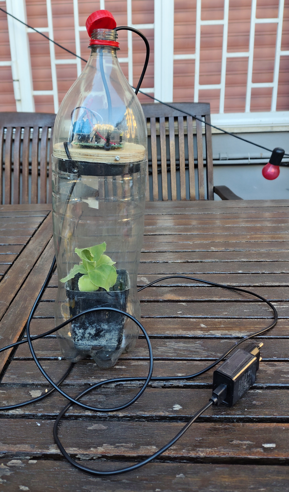
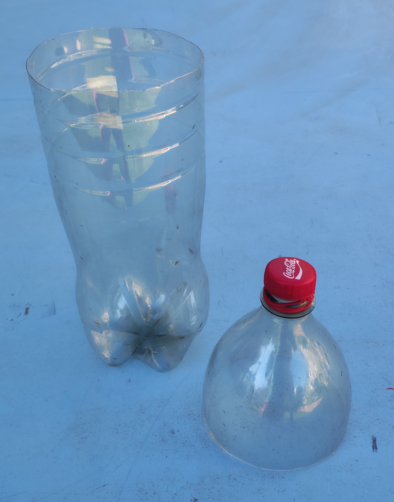
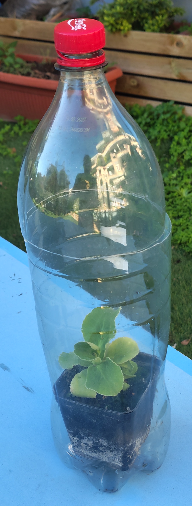
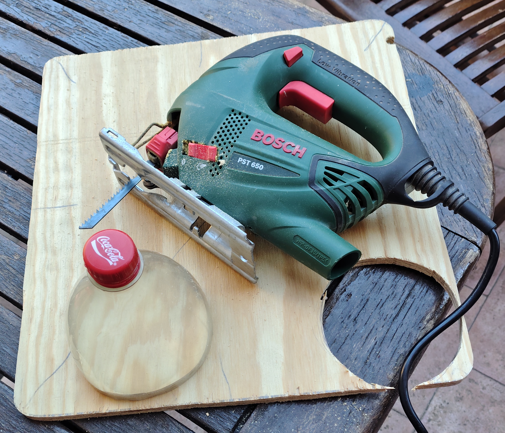
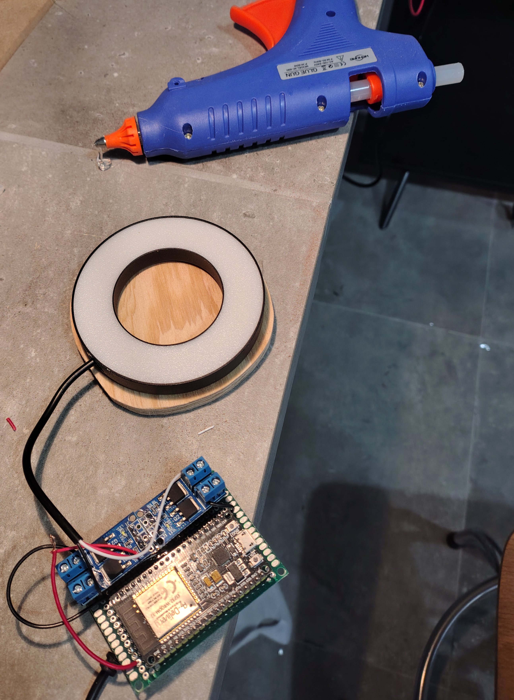
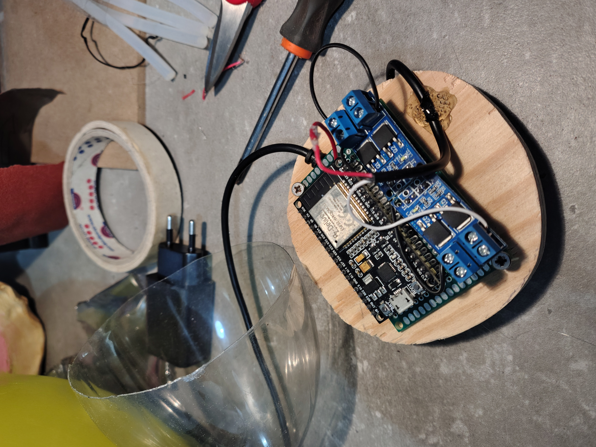
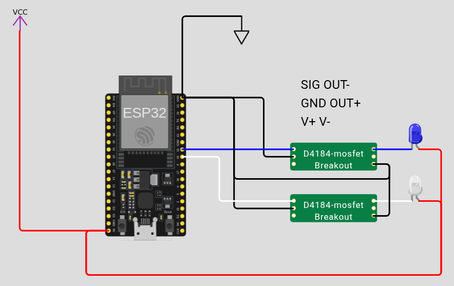
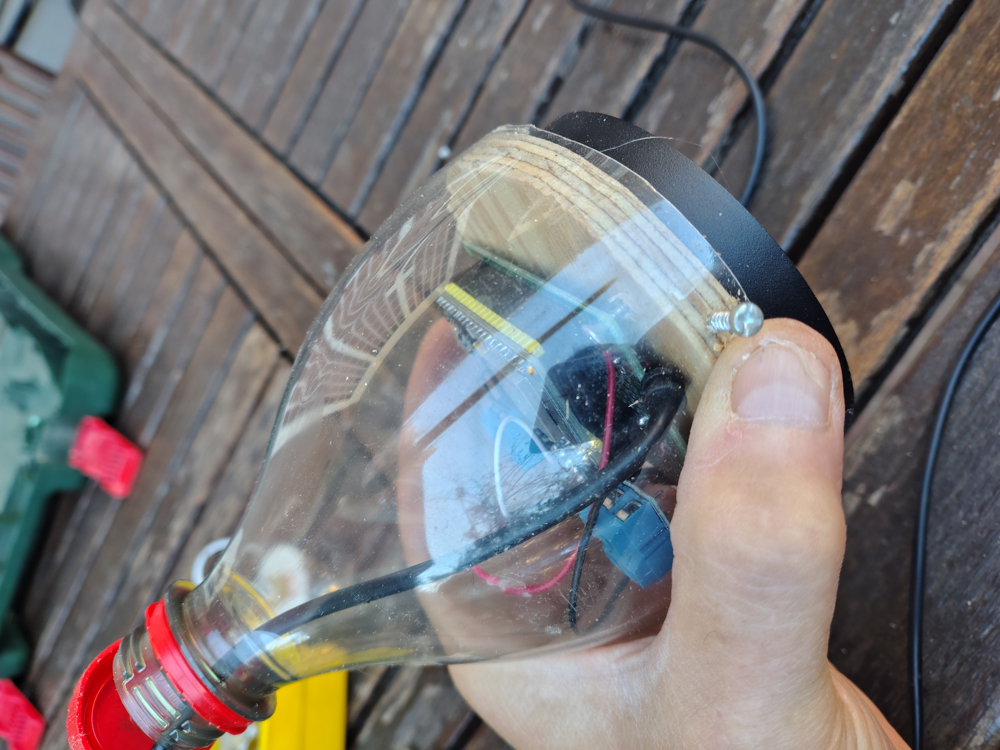
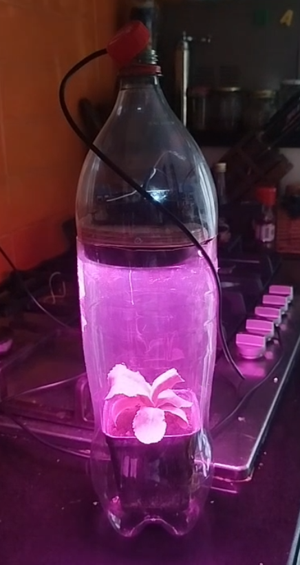
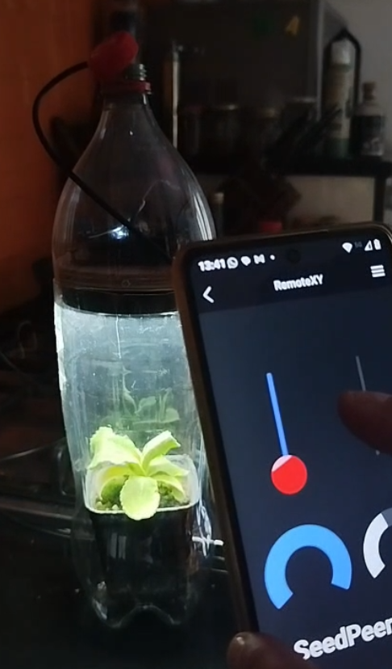

# Build your SeedPeers micro greenhouse

A micro-greenhouse made from a recycled 2 L PET bottle of Coca-Cola. It has a grow light and an
ESP32 that you control from your smartphone.



---

## What you need

### Materials

| #   | Item                              | Qty | Notes                                                                                                                                    |
| --- | --------------------------------- | --- | ---------------------------------------------------------------------------------------------------------------------------------------- |
| 1   | Empty 2 L PET bottle with cap     | 1   | Clear plastic, label removed                                                                                                             |
| 2   | Plywood board                     | 1   | About 1cm thick. You cut a disc from it the size of the bottle                                                                           |
| 3   | LED ring grow light               | 1   | [A possible LED ring grow light](https://www.amazon.it/dp/B0BVLWW1KY?ref=ppx_yo2ov_dt_b_fed_asin_title&th=1) |
| 4   | ESP32 dev board (ESP32-WROOM-32)  | 1   | Mounted on a perfboard                                                                                                                   |
| 5   | Dual MOSFET driver module         | 1   | Switches/dims the LED ring. [A possible Dual MOSFET driver module](https://www.amazon.it/dp/B0CF5TS3YL?ref=ppx_yo2ov_dt_b_fed_asin_title)                   |
| 6   | Perfboard + jumper wires          | 1   |                                                                                                                                          |
| 7   | USB power supply + cable          | 1   | 5 V, >  1.5A                                                                                                              |
| 8   | Small wood screws                 | 4–6 | To fix the board and the bottle top to the disc                                                                                          |
| 9   | Hot-glue sticks                   | –   |                                                                                                                                          |
| 10  | Small plant pot + soil + seedling | 1   | Must fit inside the bottle                                                                                                               |

### Tools

- Cutter / sharp scissors
- Jigsaw (or coping saw)
- Hot-glue gun
- Screwdriver
- Pencil, masking tape
- Soldering iron *(optional, for the perfboard)*

!!! Danger
    wear eye protection when you use the jigsaw. Keep fingers away from the blade and be careful with the cutter on curved plastic. Hot glue causes burns.

---

## Step 1 – Cut the bottle



1. Wrap a strip of masking tape around the bottle at **__ cm** from the base (TODO). Use it as your cutting guide.
2. Cut along the tape with the cutter, then finish the cut with scissors.
3. You now have two parts:
   - the **bottom part**, which holds the plant,
   - the **top part** (shoulder + cap), which becomes the lid.

**Tip:** smooth the cut edges so they don't scratch.

---

## Step 2 – Check the fit (basic greenhouse)



Put the potted seedling in the bottom part and slide the top part over it. This is
already a working passive greenhouse. The next steps add the light and the electronics.

---

## Step 3 – Cut the wooden disc



1. Place the top part of the bottle on the plywood and trace around it with a pencil.
2. Cut out the disc with the jigsaw. Stay slightly **inside** the line so the disc fits snugly inside the bottle.
3. Sand the edges.

---

## Step 4 – Mount the LED ring



1. Hot-glue the LED ring to the **underside** of the disc so the light points down at the plant.
2. Route the LED cable to the top side of the disc.

---

## Step 5 – Mount the electronics



1. Screw the perfboard with the ESP32 and the MOSFET module onto the **top side** of the disc.
2. Wire the parts as follows:

   | From                 | To                                   |
   | -------------------- | ------------------------------------ |
   | ESP32 GPIO __ (TODO) | MOSFET module IN1                    |
   | ESP32 GND            | MOSFET module GND                    |
   | LED ring + / –       | MOSFET module OUT1                   |
   | USB 5 V / GND        | ESP32 VIN / GND and MOSFET module V+ |

3. Fix the cables with a drop of hot glue (strain relief).

<!-- TODO: add a wiring diagram, e.g. ./wiring.png -->


```cpp
const int PIN_Q1_SPECTRUM_1 = 19; // PWM Canale 1 (Rosso/Blu)
const int PIN_Q2_SPECTRUM_2 = 18; // PWM Canale 1 (Rosso/Blu)
const int PWM_FREQ = 5000;
const int PWM_RESOLUTION = 8;

void setLampState(int brightnessQ1, int brightnessQ2) {
  // Con il Core v3.x usi direttamente il numero del PIN
  ledcWrite(PIN_Q1_SPECTRUM_1, brightnessQ1);
  ledcWrite(PIN_Q2_SPECTRUM_2, brightnessQ2);
}

void setup() {
  Serial.begin(115200);

  // Sintassi ESP32 Core v3.x: associa pin, frequenza e risoluzione in un solo passaggio
  ledcAttach(PIN_Q1_SPECTRUM_1, PWM_FREQ, PWM_RESOLUTION);
  ledcAttach(PIN_Q2_SPECTRUM_2, PWM_FREQ, PWM_RESOLUTION);
  
  setLampState(0,255);
  Serial.println("ready");
}

void loop() {
  Serial.println("ramping up");
  for (int duty = 0; duty <= 255; duty += 5) {
    setLampState(duty, 255-duty);
    Serial.print("duty: ");
    Serial.println(duty);
    delay(20);
  }

  delay(1000);

  Serial.println("ramping down");
  for (int duty = 255; duty >= 0; duty -= 5) {
    setLampState(duty, 255-duty);
    Serial.print("duty: ");
    Serial.println(duty);
    delay(20);
  }
}
```

This code is available [here](https://wokwi.com/projects/477929549130673153)
---

## Step 6 – Close the lid



1. Pass the power cable through the bottle neck. Drill a hole in the cap or leave the cap off.
2. Slide the top part of the bottle over the disc and fix it with small screws through the plastic into the edge of the disc.

---

## Step 7 – Assemble the greenhouse


1. Put the potted plant in the bottom part.
2. Rest the lid unit (disc + electronics + top part) on the bottom part.
3. Plug the USB cable into the power supply.

---

## Step 8 – Upload the firmware

1. Install the Arduino IDE (or PlatformIO) and the ESP32 board support.
2. Open the firmware: [https://github.com/andreavitaletti/PlatformIO/tree/main/Projects/seedpeers](https://github.com/andreavitaletti/PlatformIO/tree/main/Projects/seedpeers).
3. Set your parameters (Wi-Fi / Bluetooth, RemoteXY token, …).
4. Upload the sketch to the ESP32 over USB.

---

## Step 9 – Turn on the grow light



When powered, the LED ring lights up the plant with the grow spectrum (pink/purple light).

---

## Step 10 – Control it from your smartphone



1. Install **RemoteXY** on your phone.
2. Connect to the **SeedPeers** device.
3. Use the controls to set the light intensityhttps://github.com/andreavitaletti/PlatformIO/tree/main/Projects/seedpeers.

---
